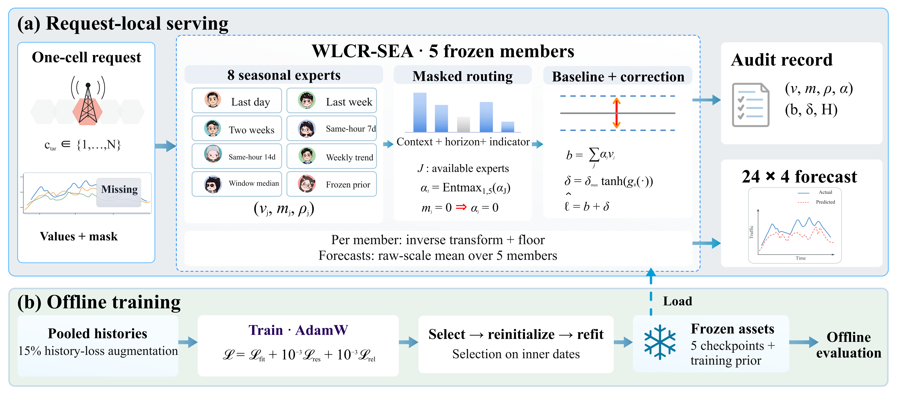

<p align="center">
  
</p>

<p align="center">
  <strong>Forecast one cell's next 24 hours from its own recent history, even when some telemetry is missing.</strong>
</p>

<p align="center">
  <a href="docs/index.md">Website</a> ·
  <a href="docs/local-demo.md">Local Demo</a> ·
  <a href="MODEL_CARD.md">Model Card</a> ·
  <a href="demo/checkpoints/">Pinned Weights</a> ·
  <a href="#research-dataset">Dataset</a> ·
  <a href="README_CN.md">中文</a>
</p>

WLCR-SEA reads one cell's previous **336 hours × 4 traffic indicators** and
forecasts its next **24 hours × 4 indicators**. Inference uses only the current
cell's data and the published model weights; it does not fetch live traffic
from other cells. The public Demo runs a five-model ensemble built from the
same released checkpoints used for the reported results.

## Why WLCR-SEA

- **Uses one cell's data.** Each prediction is a sealed one-cell computation.
  Cell identity is retained for validation and audit matching, but it is not
  used to query another live data source.
- **Handles missing readings.** Eight seasonal experts represent daily, weekly,
  robust-median, trend, request-level, and frozen-prior patterns. If an expert
  depends on unavailable history, hard masking gives it exactly zero routing
  weight.
- **Shows how the forecast was built.** A request can export expert values,
  availability, routing weights, bounded residuals, checkpoint identities, and
  range checks. Paired with the original request and pinned source revision,
  the record supports review and replay. It explains internal allocation, not
  causal effects or calibrated uncertainty.

This is a research implementation for constrained data access and missing
telemetry. It is not presented as a universally best forecaster or as a privacy
system.

## Method

<p align="center">
  <a href="docs/images/paper_figure_framework.png">
    
  </a>
</p>

First, WLCR-SEA constructs eight seasonal experts from the 336-hour request and
each checkpoint's frozen training prior. Second, reliability-aware Entmax
routing operates only on the available expert set, so unusable experts remain
at zero weight. Finally, a bounded residual produces the 24-hour forecast while
preserving a checkable envelope. The five trained models are combined by averaging
their predictions in linear traffic space.

The full expert definitions, availability rules, and equations are on the
[Method page](docs/guide/method.md).

## Evidence

| Question | Reported result |
| --- | --- |
| Complete history | DLinear has lower macro-indicator WAPE in the reported comparison: **0.1854** versus **0.1955** for the five-member WLCR-SEA ensemble. |
| Severe missingness | WLCR-SEA has lower macro-indicator WAPE in all **9 prespecified comparisons** against DLinear-Aug, PatchTST-Aug, and GRU-D under the study's severe missingness settings. |
| Audit checks | Unavailable-expert weight is **0** and reported bounded-envelope violations are **0**. |
| CPU inference | The five-member ensemble reports **34.705 ms median / 38.684 ms P99** at batch 1 with one CPU thread; model assets total **148.8 KiB**. |

These results come from one anonymous region and roughly one month of data.
They should not be treated as deployment guarantees. See [Results and
limitations](docs/research/evidence.md)
for the protocol, confidence intervals, missingness patterns, and scope.

Metric labels are intentionally explicit. **Macro-indicator WAPE** computes
WAPE separately for the four indicators and averages those values;
**macro-cell WAPE** averages cell-level values, while **pooled WAPE** combines
the numerator and denominator over all evaluated points. Results from these
different aggregation schemes are not silently compared.

## Run

The [browser-local Demo](docs/local-demo.md) runs without installing model dependencies. See [REVIEW.md](REVIEW.md) to serve the bundled website on localhost. The five models run on your computer and CSV contents stay on your device. The former hosted Hugging Face experience is retired.

<details>
<summary>Optional: run the Python interface locally</summary>

```bash
cd /path/to/review-package
python -m pip install -r requirements-demo.txt
python demo/app.py
```

The app reads and verifies the five bundled model checkpoints and automatically
previews a synthetic 336-hour sample. Click **Run forecast** to create the
downloadable forecast CSV and versioned audit JSON. The local Python interface
accepts CSV files up to 5 MB.

</details>

## Research dataset

The experiments use the training CSV inside a
[Huawei-hosted online-stage archive](https://res-static.hc-cdn.cn/cloudbu-site/china/zh-cn/wuxian-gaoxiao2026/1780886490950118786.zip).
Extract `线上阶段数据集/AI数据集/train_data.csv` to `data/train_data.csv` and
verify SHA-256 `d274407a3db51ba4871851ab447bcc75202bb567337464d85ea280662f3bf1da`.
The source archive does not include a separate data-license file. This project
does not redistribute the data, and its Apache-2.0 code license does not grant
rights to the dataset; use it only under the source provider's applicable
terms. Exact download, archive hash, and extraction commands are in
[`REPRODUCTION.md`](REPRODUCTION.md#3-input-data).

## Reproduce, cite, and license

- **Reproduce:** follow [`REPRODUCTION.md`](REPRODUCTION.md) for inputs,
  installation, public-checkpoint verification, tests, training, and evidence
  generation.
- **Cite:** author information is withheld during anonymous review. Refer to
  release `ensemble-v1` and the checksums in `demo/checkpoints/SHA256SUMS`.
  Machine-readable metadata is in [`CITATION.cff`](CITATION.cff).
- **License:** Apache License 2.0; see [`LICENSE`](LICENSE).
